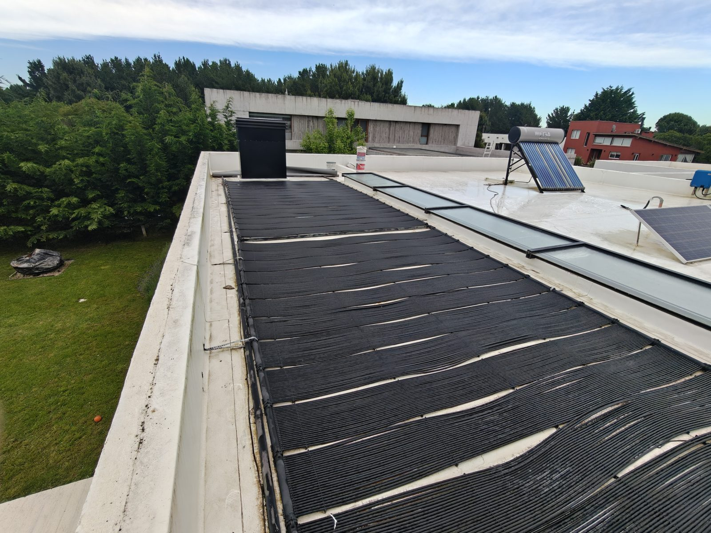
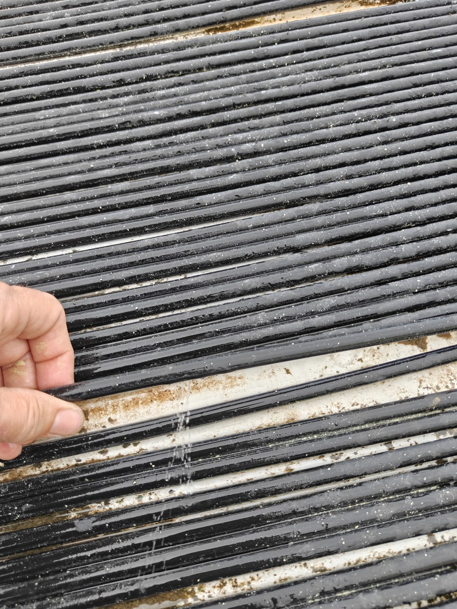
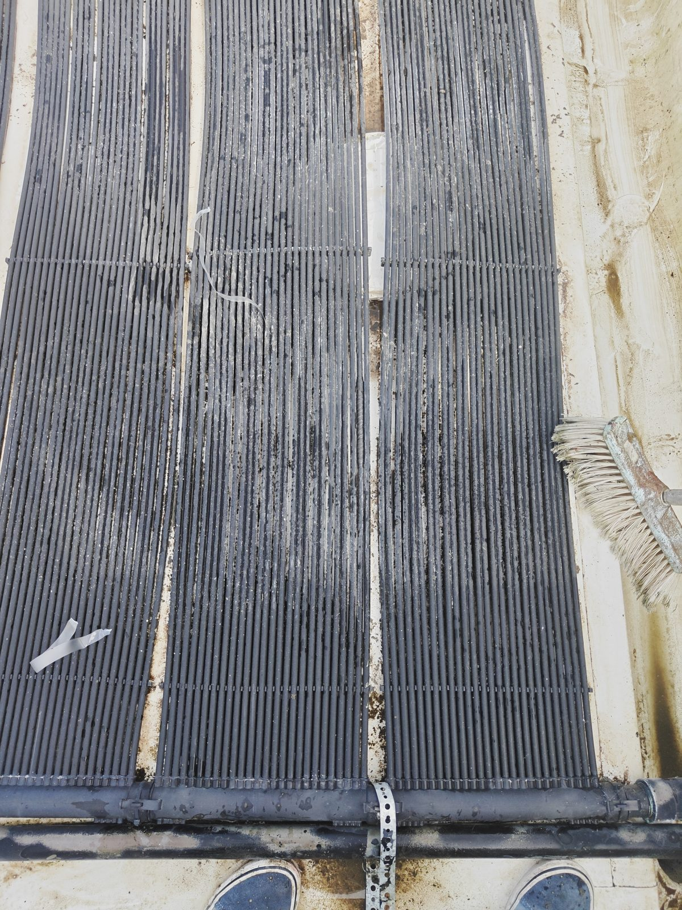
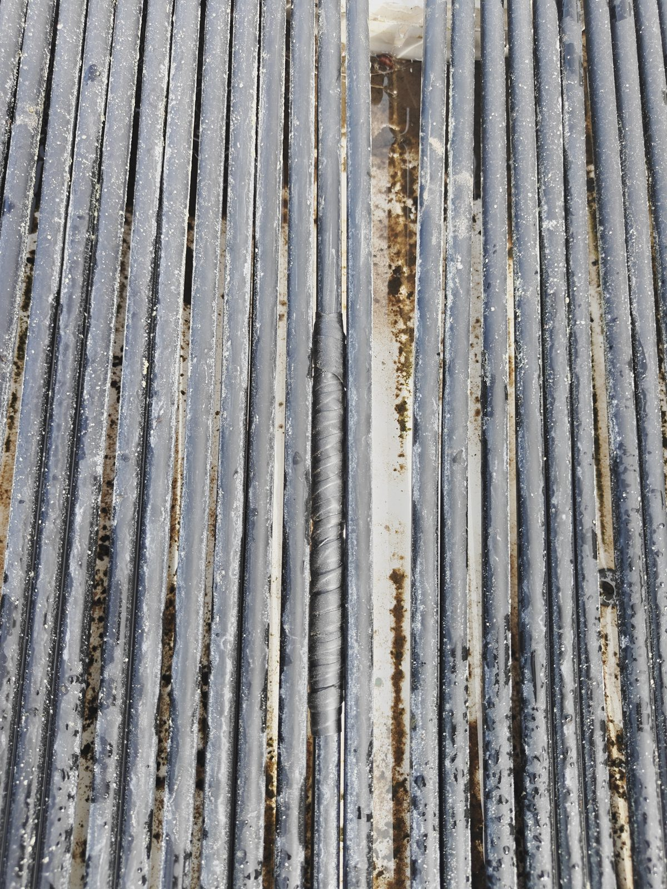

# Costa 204: registro de mantenimiento

## Colector solar de la pileta (techo)

Paños de manguera de polipropileno negro sobre el techo. La bomba del filtro
(`switch.psw_4ch_cbu_switch_1`) hace circular el agua de la pileta por los paños. Lo controlan
`automation.colector_solar_encendido` (diferencia > `input_number.diferencial_encendido`) y
`automation.colector_solar_apagado` (diferencia baja durante 30 min, o puesta del sol).

Estado general (11/11/2026): varios paños están deformados y separados, con tubos ondulados y
huecos entre paños, sobre todo hacia los extremos. Es el desgaste típico por calor y edad.
Ahí es más probable que aparezcan fisuras.

### 11/11/2026: prueba de pérdidas

- Para probar, se pausó `automation.colector_solar_apagado` y se prendió la bomba a mano.
  **Reactivar la automatización al terminar.**
- Pérdida encontrada: un tubo rajado. Salía agua en chorrito.

  

- Reparación provisoria: **cinta autosoldable** sobre la rajadura. Está en la última fila de
  paños antes del caño colector, en el paño del medio, junto a la unión entre paños.

  
  

- Esa mañana el filtro se prendía y se cortaba cada 3 a 5 min, y el colector no arrancaba.
  La causa: el **sensor de nivel del skimmer** (flotante Tuya, `switch.nivel_skimmer_switch_1`)
  quedó **trabado físicamente** marcando "bajo". El nivel había bajado tanto que el flotante
  se fue para atrás y no volvió solo. Se destrabó a mano y volvió a "con agua" a las 09:12.
  Si el filtro cicla con el canal lleno, revisar primero ese flotante. La cámara
  (`sensor.pileta_canal_skimmer`) sirve para comparar.
- Revisar en la próxima visita: que la cinta siga sellando con el colector caliente, y una
  posible marca o agujero en un tubo del borde derecho de la foto de la cinta, a la altura del
  final del parche.

## Seguimiento del colector solar y del consumo de las bombas (desde 11/11/2026)

Objetivo: decidir con datos si se ajustan los diferenciales (encendido 7 °C, apagado 2,5 °C,
mínimo 30 min andando y 15 min apagada) y cuánto cuesta en luz climatizar la pileta, para
cobrar a los huéspedes el excedente sobre el básico.

**Sensores que se cruzan** (todos con estadísticas de largo plazo):

| Qué | Entidad |
|---|---|
| Bomba filtro (on/off) | `switch.psw_4ch_cbu_switch_1` |
| Potencia y energía del filtro (estimadas, 950 W) | `sensor.filtro_pileta_potencia_estimada`, `sensor.filtro_pileta_energia` |
| Arranques del filtro por día | `sensor.exterior_controlador_nicho_pileta_filtro_pileta_arranques_hoy` |
| Horas del filtro por día | `sensor.exterior_controlador_nicho_pileta_filtro_pileta_horas_hoy` |
| Bomba de riego: potencia y energía (1720 W, medidos en la fase S) | `sensor.bomba_riego_potencia_estimada`, `sensor.bomba_riego_energia` |
| Temperatura del colector (sensor sobre los paños) | `sensor.sonoff_1002216f84_temperature` |
| Temperatura de la pileta, cruda | `sensor.sonoff_10022162b2_temperature` |
| **Temperatura de la pileta con circulación** (válida) | `sensor.temperatura_pileta_con_circulacion` |
| Diferencia colector − pileta | `sensor.diferencia_temperatura_pileta` |
| Sol (proxy de radiación) | `sensor.sn_3017553941_pv_power`, `sensor.sn_3017553941_daily_yield` (inversor fotovoltaico) |
| Clima | `sensor.openweathermap_temperature`, `_cloud_coverage`, `_uv_index`, `_wind_speed` |
| Tarifa | `input_number.tarifa_kwh_ars` (125,75 $/kWh sin impuestos; factura real ≈ 375 $/kWh) |

**Ojo con el sensor de la pileta:** está en el nicho, pegado por fuera al caño de plástico. No
mide el agua directamente: solo refleja la temperatura del agua con la bomba andando, y aun así
con algo de retraso. Con la bomba parada mide el nicho. Por eso:
- `sensor.temperatura_pileta_con_circulacion` toma el valor solo cuando la bomba lleva más de
  5 min andando, y si no, mantiene el último válido.
- `sensor.diferencia_temperatura_pileta`, que usan las automatizaciones, sigue usando el valor
  crudo. Con la bomba parada, la diferencia compara el colector contra el nicho, no contra el
  agua. Evaluar si conviene que el encendido use el valor con circulación.

**A analizar**: arranques/día, horas/día, kWh y $ por día, °C ganados por día en la pileta,
°C por kWh, relación con la producción FV, la nubosidad, el viento y la temperatura exterior, y
si el apagado corta mientras todavía hay ganancia.
