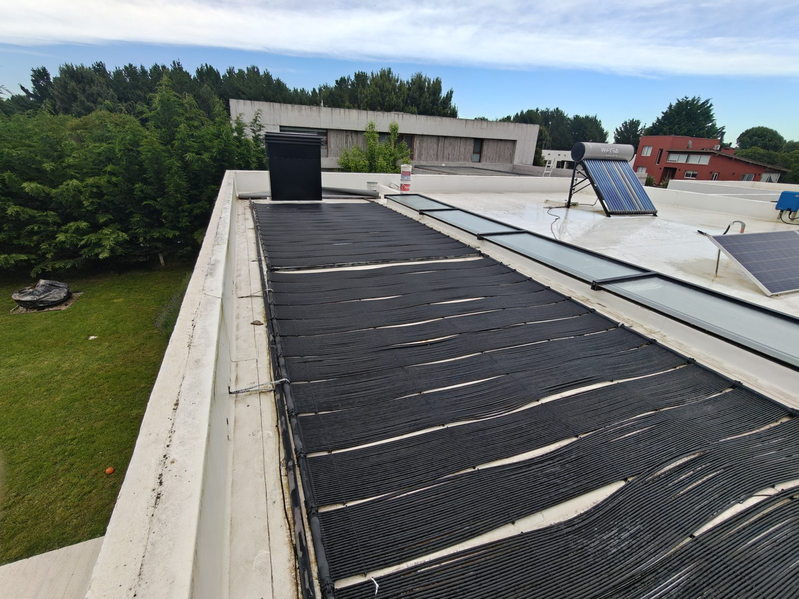
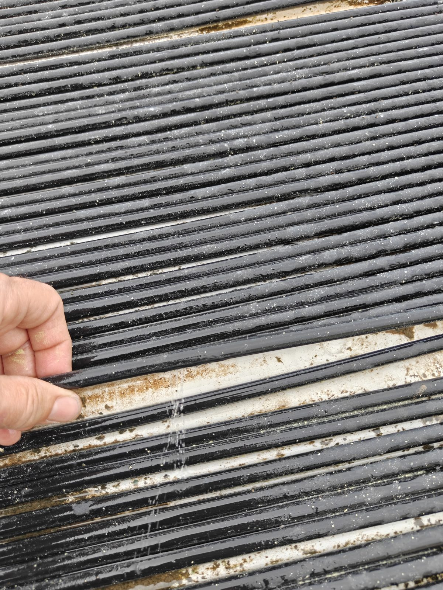
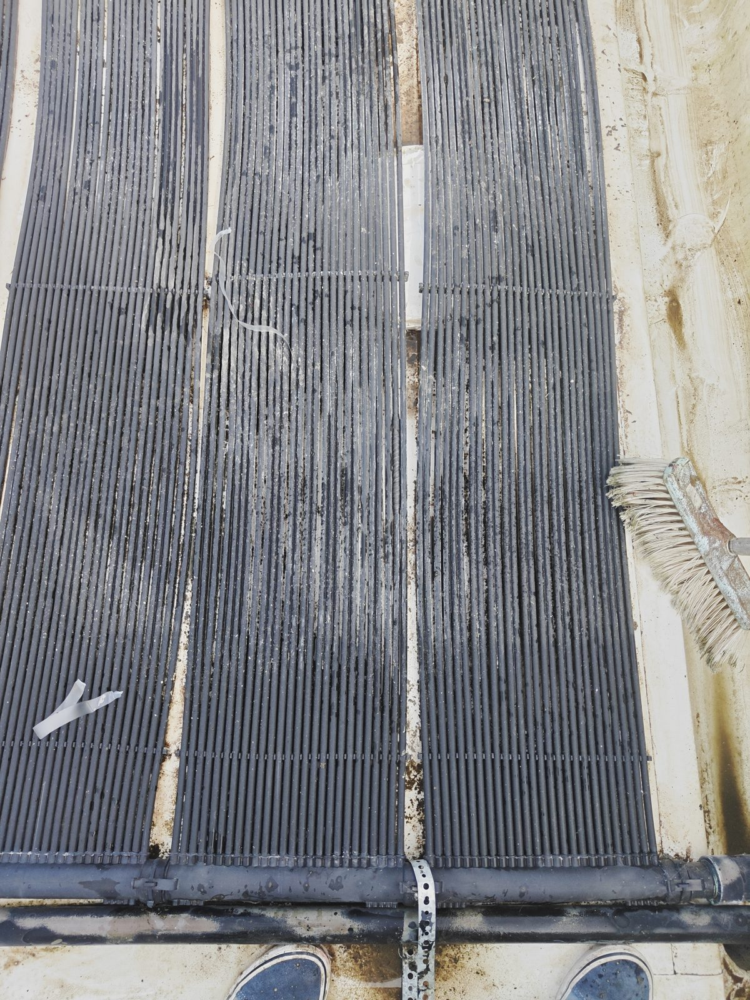
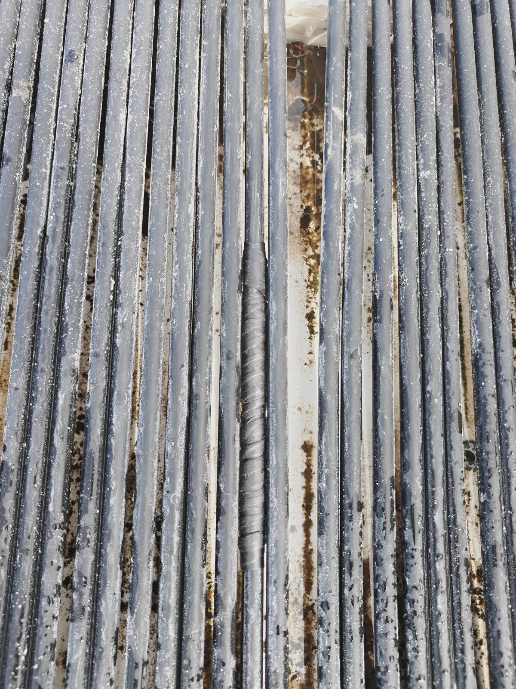
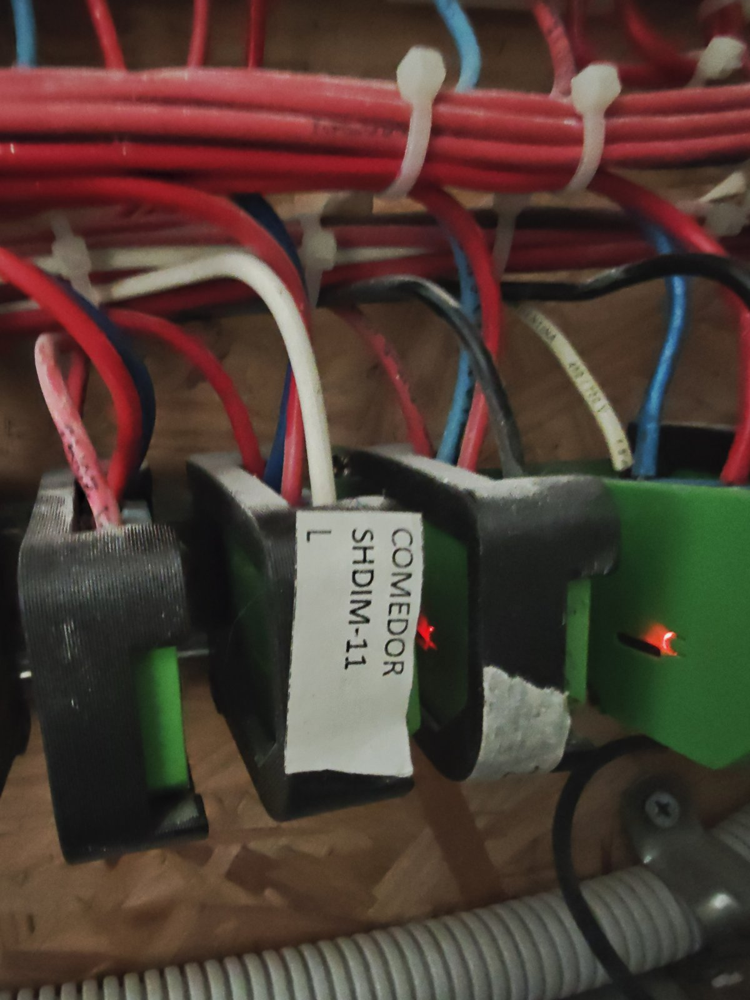

# Costa 204: registro de mantenimiento

## Colector solar de la pileta (techo)

Paños de manguera de polipropileno negro sobre el techo. La bomba del filtro
(`switch.psw_4ch_cbu_switch_1`) hace circular el agua de la pileta por los paños. Lo controlan
`automation.colector_solar_encendido` (diferencia > `input_number.diferencial_encendido`) y
`automation.colector_solar_apagado` (diferencia baja durante 30 min, o puesta del sol).

Estado general (11/11/2026): varios paños están deformados y separados, con tubos ondulados y
huecos entre paños, sobre todo hacia los extremos. Es el desgaste típico por calor y edad.
Ahí es más probable que aparezcan fisuras.

### 11/11/2026: prueba de pérdidas

- Para probar, se pausó `automation.colector_solar_apagado` y se prendió la bomba a mano.
  **Reactivar la automatización al terminar.**
- Pérdida encontrada: un tubo rajado. Salía agua en chorrito.

  

- Reparación provisoria: **cinta autosoldable** sobre la rajadura. Está en la última fila de
  paños antes del caño colector, en el paño del medio, junto a la unión entre paños.

  
  

- Esa mañana el filtro se prendía y se cortaba cada 3 a 5 min, y el colector no arrancaba.
  La causa: el **sensor de nivel del skimmer** (flotante Tuya, `switch.nivel_skimmer_switch_1`)
  quedó **trabado físicamente** marcando "bajo". El nivel había bajado tanto que el flotante
  se fue para atrás y no volvió solo. Se destrabó a mano y volvió a "con agua" a las 09:12.
  Si el filtro cicla con el canal lleno, revisar primero ese flotante. La cámara
  (`sensor.pileta_canal_skimmer`) sirve para comparar.
- Medición de la pérdida con el parche puesto: recipiente debajo del parche, **900 ml**
  juntados hasta las ~14:10 del 11/11. La bomba anduvo sin cortes desde las 09:12, así que son
  ≈ 4,5–5 h de circulación → **≈ 180–200 ml/h** (≈ 1,5–2 L por día de colector). La cinta
  redujo el chorrito a goteo pero **no sella del todo**. Hora exacta en que se puso el
  recipiente: a confirmar.
- Revisar en la próxima visita: que la cinta siga sellando con el colector caliente, y una
  posible marca o agujero en un tubo del borde derecho de la foto de la cinta, a la altura del
  final del parche.

## Seguimiento del colector solar y del consumo de las bombas (desde 11/11/2026)

Objetivo: decidir con datos si se ajustan los diferenciales (encendido 7 °C, apagado 2,5 °C,
mínimo 30 min andando y 15 min apagada) y cuánto cuesta en luz climatizar la pileta, para
cobrar a los huéspedes el excedente sobre el básico.

**Sensores que se cruzan** (todos con estadísticas de largo plazo):

| Qué | Entidad |
|---|---|
| Bomba filtro (on/off) | `switch.psw_4ch_cbu_switch_1` |
| Potencia y energía del filtro (estimadas, 950 W) | `sensor.filtro_pileta_potencia_estimada`, `sensor.filtro_pileta_energia` |
| Arranques del filtro por día | `sensor.exterior_controlador_nicho_pileta_filtro_pileta_arranques_hoy` |
| Horas del filtro por día | `sensor.exterior_controlador_nicho_pileta_filtro_pileta_horas_hoy` |
| Bomba de riego: potencia y energía (1720 W, medidos en la fase S) | `sensor.bomba_riego_potencia_estimada`, `sensor.bomba_riego_energia` |
| Temperatura del colector (sensor sobre los paños) | `sensor.sonoff_1002216f84_temperature` |
| Temperatura de la pileta, cruda | `sensor.sonoff_10022162b2_temperature` |
| **Temperatura de la pileta con circulación** (válida) | `sensor.temperatura_pileta_con_circulacion` |
| Diferencia colector − pileta | `sensor.diferencia_temperatura_pileta` |
| Sol (proxy de radiación) | `sensor.sn_3017553941_pv_power`, `sensor.sn_3017553941_daily_yield` (inversor fotovoltaico) |
| Clima | `sensor.openweathermap_temperature`, `_cloud_coverage`, `_uv_index`, `_wind_speed` |
| Tarifa | `input_number.tarifa_kwh_ars` (125,75 $/kWh sin impuestos; factura real ≈ 375 $/kWh) |

**Ojo con el sensor de la pileta:** está en el nicho, pegado por fuera al caño de plástico. No
mide el agua directamente: solo refleja la temperatura del agua con la bomba andando, y aun así
con algo de retraso. Con la bomba parada mide el nicho. Por eso:
- `sensor.temperatura_pileta_con_circulacion` toma el valor solo cuando la bomba lleva más de
  5 min andando, y si no, mantiene el último válido.
- `sensor.diferencia_temperatura_pileta`, que usan las automatizaciones, sigue usando el valor
  crudo. Con la bomba parada, la diferencia compara el colector contra el nicho, no contra el
  agua. Evaluar si conviene que el encendido use el valor con circulación.

**A analizar**: arranques/día, horas/día, kWh y $ por día, °C ganados por día en la pileta,
°C por kWh, relación con la producción FV, la nubosidad, el viento y la temperatura exterior, y
si el apagado corta mientras todavía hay ganancia.

### 1.ª entrega (15/11/2026, datos del 11/11 al 15/11 10:00)

Bomba del filtro estimada en 950 W. "Pileta mañana" = lectura del sensor con circulación a las
9:05 (primeros minutos de marcha, antes de que el colector aporte): es lo más parecido a la
temperatura real del agua.

| Día | Sol (FV) | Nubes | T ext. media | Arranques | Horas filtro | kWh filtro | kWh riego | Pileta mañana → mañana siguiente |
|---|---|---|---|---|---|---|---|---|
| 11/11 | 29,1 kWh | 75 % | 22,2 °C | 13 | ≈ 8,0 | ≈ 7,6 (sensor creado ese día: 5,4) | 1,0 | 22,2 → 24,0 (**+1,8 °C**) |
| 12/11 | 31,2 kWh | 70 % | 21,5 °C | 4 | 4,2 | 4,0 | 2,5 | 24,0 → (13/11 sin lectura) |
| 13/11 | 21,0 kWh | 95 % | 19,3 °C | 4 | 0,2 | 0,2 | 2,5 | → 23,9 el 14/11 (12 y 13: **≈ 0 °C** en dos días) |
| 14/11 | 30,8 kWh | 76 % | 19,0 °C | 3 | 6,4 | 6,0 | 1,4 | 23,9 → 25,3 (**+1,4 °C**) |
| 15/11 (hasta 10 h) | — | 93 % | 17,6 °C | 1 | 0,9 | 0,9 | 0,3 | 25,3 |

Hallazgos:

1. **El llenado automático quedó apagado desde el 11/11 13:10** (automatización "Pileta: llenado
   por cámara + sensor Tuya" en `off`; la electroválvula `switch.sonoff_1001d8d053_1` no abrió
   ni una vez desde el 12/11). Con el canal del skimmer bajo, "proteger filtro sin agua" corta la
   bomba a los 3 min. Consecuencias:
   - 12/11: corte a las 9:55 y el colector quedó parado de 9:52 a 11:55 entre 40 y 59 °C (las
     mejores 2 h de sol perdidas); otro corte a las 15:04.
   - 13/11: canal bajo todo el día → 4 arranques de 3 min, **sin calentar y sin filtrar** (el
     filtrado mínimo de las 23:00 también se cortó a los 3 min).
   - Desde el 14/11 1:52 el canal está bien y la bomba anda normal.
   - **Acción: volver a encender el llenado** (o hacer la prueba del balde y encenderlo al
     terminar).
2. **Los arranques de 3 min no son ciclado del colector:** son el filtro periódico (9:00,
   10:30, 12:30, 16:30) y el filtrado de las 23:00 cortados por la protección del skimmer. El
   único ciclado real fue el 11/11 entre 7:57 y 9:02 (11 arranques), mientras se ajustaban las
   automatizaciones; después no se repitió.
3. **El apagado a 2,5 °C corta bien a la tarde** (11/11 16:06, 14/11 15:33: colector ≈ agua).
   A la mañana corta temprano: el filtro periódico arranca a las 9:00 con poco sol (FV 1–2 kW),
   con la bomba andando el colector baja casi a la temperatura del agua y a los ~50 min
   (14/11 9:48, 15/11 9:53) la diferencia cae bajo 2,5 °C. Vuelve a arrancar a los 15–40 min.
   Se pierde poco (≈ 40 min de sol flojo), pero suma un arranque por día.
4. **`sensor.temperatura_pileta_con_circulacion` sobrestima el agua de día:** sube ≈ 1 °C por
   hora mientras circula (22 → 28 °C el 11/11; 25,4 → 30,4 °C el 12/11), cosa imposible para el
   volumen de la pileta. El sensor del nicho está en el caño que trae el agua caliente del
   colector, o lo calienta el sol del nicho. Sirve como temperatura del agua solo en los primeros
   minutos de la mañana. Para medir la ganancia real, poner una sonda en el skimmer o en la
   succión.
5. **Ganancia:** en un día de sol completo (FV ≈ 30 kWh) la pileta gana neto **+1,4 a +1,8 °C**
   por día, con 6–8 h de bomba (6–7,6 kWh). Un día nublado como el 13/11 pierde lo ganado.

Costo de climatizar (bomba del filtro; sin contar el riego):

| | kWh | A 125,75 $/kWh (tarifa sin impuestos) | A ≈ 375 $/kWh (factura real) |
|---|---|---|---|
| 1 h de bomba | 0,95 | ≈ $ 120 | ≈ $ 356 |
| Día de sol completo (6–8 h) | 6–7,6 | ≈ $ 750–960 | ≈ $ 2.250–2.850 |
| Solo lo que se suma a las 4 h de filtrado mínimo (2,4–4 h) | 2,3–3,8 | ≈ $ 290–480 | ≈ $ 860–1.430 |
| Por °C ganado (día de sol) | ≈ 4,3 | ≈ $ 540 | ≈ $ 1.600 |

Recomendación (por ahora, con 4 días de datos):
- **Diferenciales: dejar 7 °C para encender y 2,5 °C para apagar.** No se vio que el apagado
  corte con ganancia a la tarde, y el encendido a 7 °C se alcanza en pocos minutos con sol.
- Mover el filtro periódico de las 9:00 a las 10:30, o no arrancarlo si la producción FV es
  menor a ~2,5 kW. Así no gasta un arranque con sol flojo.
- Para cobrar a los huéspedes: usar ≈ 3 kWh por día de sol como costo propio de climatizar (lo
  que excede al filtrado mínimo). Ya entra en los 40 kWh por día incluidos.
- Volver a revisar con más días y el llenado encendido: 2.ª entrega el 22/11/2026.

## Pendiente: prueba de pérdida de la pileta (balde)

Para hacer en otra visita. Antes de empezar, **pausar el llenado automático** (automatización
"Pileta: llenado por cámara + sensor Tuya") y reactivarlo al terminar.

1. Balde en el primer escalón, lleno con agua de la pileta al mismo nivel que la pileta.
   Marcar nivel adentro del balde y afuera (pileta).
2. 24 h con el filtro funcionando normal: medir cuánto bajó cada uno (mm). Si la pileta baja
   ≥ 3 mm/día más que el balde, hay pérdida.
3. Repetir 24 h con el filtro apagado. Si la diferencia desaparece, la pérdida está en el lado
   de presión (caños, filtro, **colector solar**); si sigue, en el vaso o la succión (skimmer,
   retornos, luz).
4. Caudal del llenado: cronometrar cuánto tarda en llenar un balde de volumen conocido
   (L/min), para traducir el tiempo de llenado automático a litros/día.
5. Pasar mm a litros: superficie de la pileta (m²) × mm = litros. Falta registrar largo y ancho.

## Shelly SHDIM-11 (spots del comedor) sin funcionar

- Equipo: Shelly Dimmer 2 `349454729610` ("SHDIM-11", circuito L de la planilla: spots del
  techo del comedor, 3 spots 8 cm; tablero 5 según diseño). En HA: `light.luz_spots_comedor`.
- Estado: **no disponible en HA al menos desde el 01/11/2026** (es lo más viejo que guarda el
  historial); el 11/11 se vio en la caja **sin LED** (los dimmers vecinos sí lo tienen) y los
  spots no prenden.
- Diagnóstico: con el circuito de iluminación cortado, revisar que L y N estén firmes en los
  bornes; volver a dar luz y medir 220 V entre L y N del Shelly. Si hay tensión y el LED sigue
  apagado, el Shelly está quemado → reemplazarlo.
- Al reemplazar: mismo cableado (L, N, O, SW1, SW2), configurar **`btn_type = dual_button`**,
  darle IP/nombre y volver a sumarlo en HA (mantener el nombre `light.luz_spots_comedor` para
  no romper paneles y automatizaciones). Revisar si los "spots estar" y "spots comedor" están
  cruzados (ver `relevamiento-teclas.md`).
