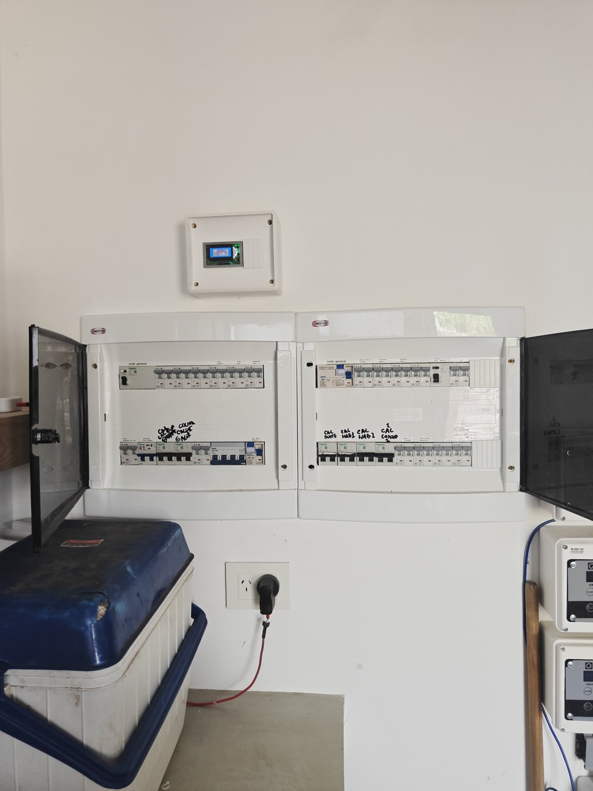
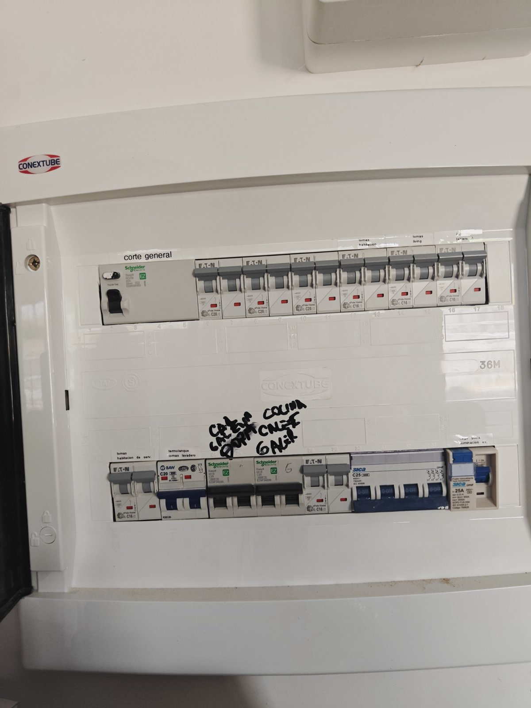
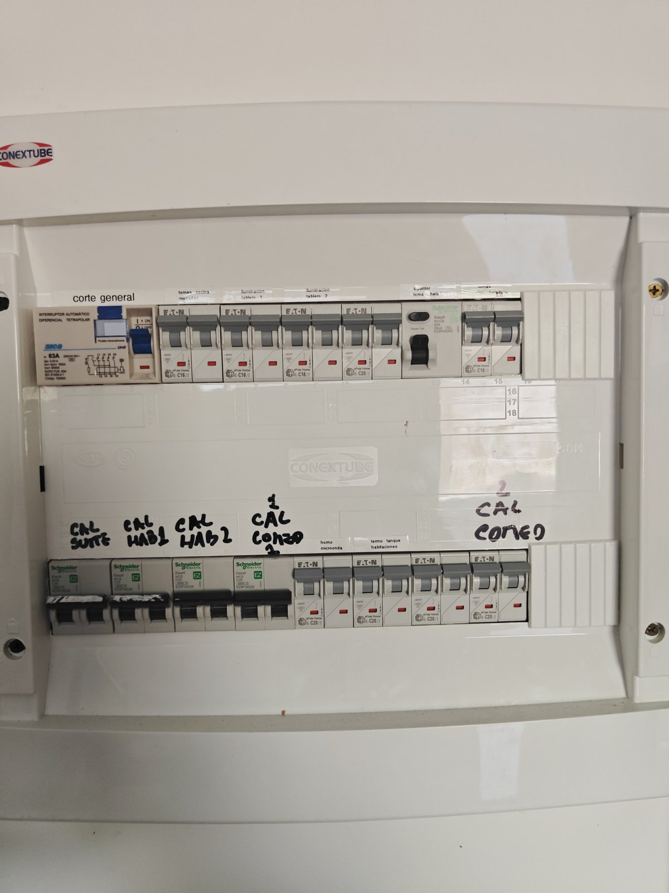
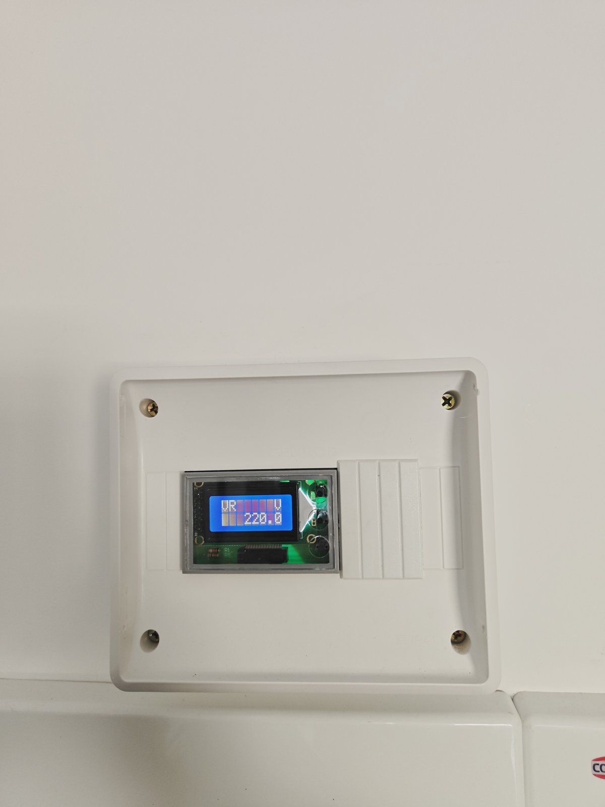
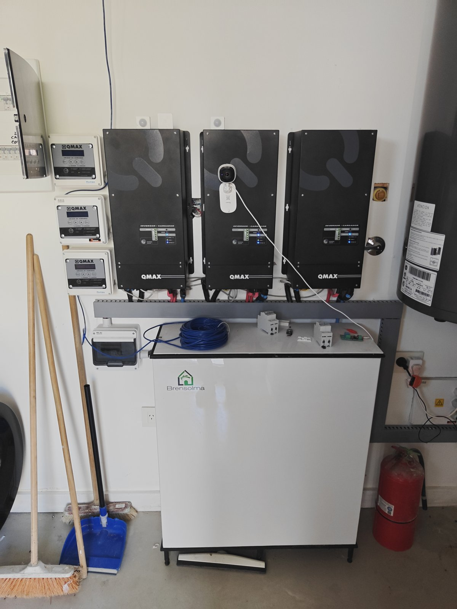
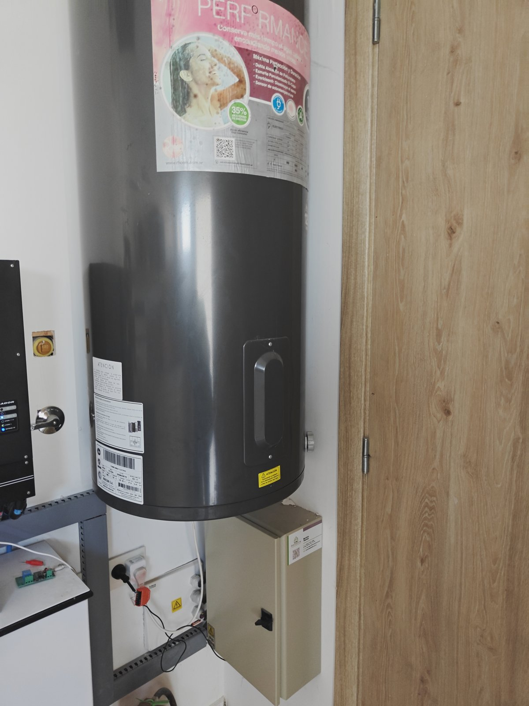
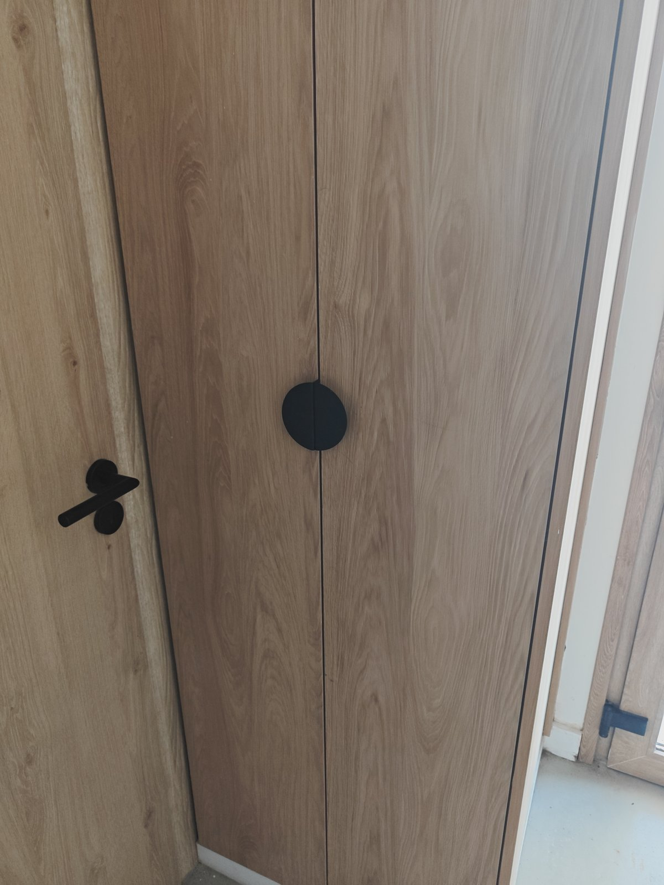
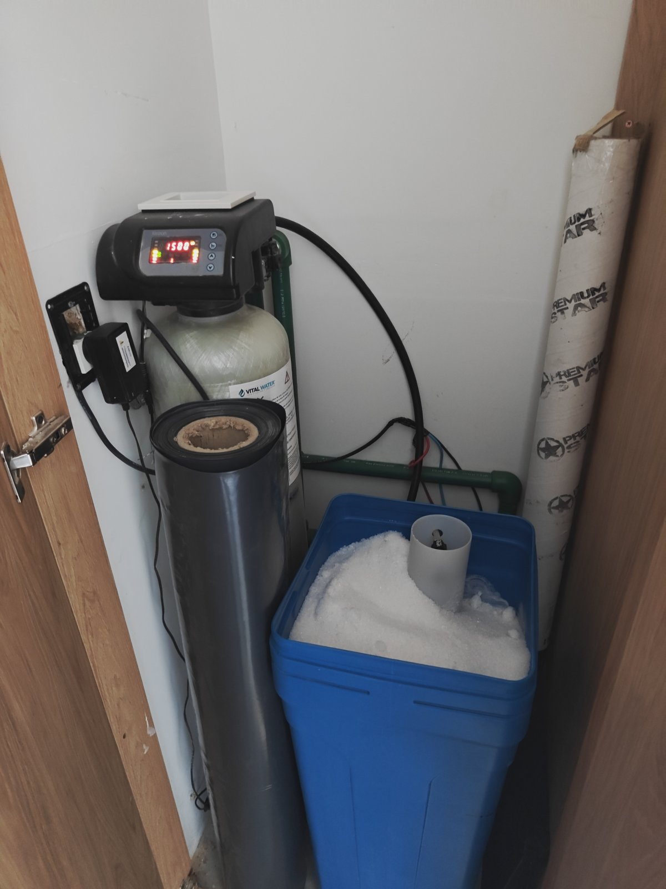

# Costa 204 — manual interno (propietarios)

Lo técnico de la casa: tableros, energía, agua y equipos. **No va a los huéspedes** (para eso
está [`manual-uso.md`](manual-uso.md)). Cada equipo tiene su nombre fijo en el
[glosario](glosario.md); las fotos están listadas en [`fotos/README.md`](fotos/README.md).
Espejo en Notion: 🔧 Manual interno (subpágina de 🌊 Costa 204).

Reglas: nada de claves ni códigos (alarma, Wi-Fi, cerraduras, cuentas de los equipos). Los
datos marcados *a confirmar* salen de leer una foto y no se verificaron en el lugar.

---

## Lavadero: el cuarto técnico de la casa

En el lavadero está casi todo lo técnico: tableros eléctricos, medidor de tensión, inversores y
baterías, termotanque, tablero de los paneles solares y sensor de corte de luz. El ablandador de
agua está en un placard aparte.

### Tableros eléctricos (térmicas y disyuntores)

Dos tableros Conextube uno al lado del otro, en la pared del lavadero, con el **medidor de
tensión** arriba. Cada uno tiene su **corte general** arriba a la izquierda.

**Tablero izquierdo**

| Fila | Posición (de izq. a der.) | Equipo | Rótulo |
|---|---|---|---|
| Arriba | 1 | Disyuntor Schneider 63 A, 30 mA | **Corte general** |
| Arriba | 2–4 | Térmicas C20 ×3 | sin rótulo legible |
| Arriba | 5 | Térmica C16 | Tomas habitación |
| Arriba | 6 | Térmica C16 | Tomas living |
| Arriba | 7 | Térmica C10 | Iluminación tablero (¿3?) |
| Abajo | 1 | Térmica C16 | Tomas habitación de servicio |
| Abajo | 2 | Térmica BAW C20 | Termotanque y tomas del lavadero |
| Abajo | 3 | Térmica Schneider C25 | A mano: calefacción … dormitorios (*a confirmar*) |
| Abajo | 4 | Térmica Schneider C25 | A mano: calefacción cocina / galería, "6" (*a confirmar*) |
| Abajo | 5 | Térmica C16 | sin rótulo |
| Abajo | 6 | Térmica tetrapolar Sica C25 | sin rótulo (*¿trifásico: aire York?*, a confirmar) |
| Abajo | 7 | Disyuntor Sica 25 A | Riego, pileta, iluminación exterior |

**Tablero derecho**

| Fila | Posición | Equipo | Rótulo |
|---|---|---|---|
| Arriba | 1 | Disyuntor tetrapolar Sica 63 A, 30 mA | **Corte general** |
| Arriba | 2 | Térmica C16 | Tomas cocina (mesadas) |
| Arriba | 3 | Térmica C16 | Iluminación tablero 1 |
| Arriba | 4 | Térmica C16 | Iluminación tablero 2 |
| Arriba | 5 | Térmica C20 | sin rótulo |
| Arriba | 6 | Disyuntor Schneider 63 A, 30 mA | Disyuntor tomas heladera |
| Arriba | 7 | Térmica C16 | Tomas heladera |
| Abajo | 1 | Schneider C20 | **CAL SUITE** (calefacción habitación principal) |
| Abajo | 2 | Schneider C20 | **CAL HAB 1** (dormitorio 1) |
| Abajo | 3 | Schneider C25 | **CAL HAB 2** (dormitorio 2) |
| Abajo | 4 | Schneider C25 | **CAL COMEDOR 1 y 2** (*a confirmar*) |
| Abajo | 5 | Térmica C20 | Horno / microondas |
| Abajo | 6 | Térmica C20 | Termotanque habitaciones |
| Abajo | 7–8 | Térmicas C20 ×2 | sin rótulo |

> Pendiente: recorrer térmica por térmica (bajarla y ver qué se apaga en HA) y completar los
> "sin rótulo". Conviene reemplazar los rótulos a mano por etiquetas impresas con estos nombres.

Si salta un disyuntor (corte general o 30 mA): suele ser humedad o un equipo con fuga
(exterior, pileta, riego). Bajar las térmicas de ese tablero, subir el disyuntor y volver a
subirlas una por una hasta ver cuál lo hace saltar.

### Medidor de tensión

Display arriba de los tableros. Muestra la tensión de cada fase (en la foto, "VR" = fase R,
220 V); con los botones se pasa a S y T. Si una fase marca muy bajo o cero, falta esa fase de
la red: avisar a la distribuidora.

> Home Assistant mide el consumo por fase con su propio medidor (R, S, T): ver
> `AGENTS.md` (aire York, bomba de riego en la fase S).

### Inversores, baterías y tablero solar

- **3 inversores/cargadores QMAX** (uno por fase) con sus **3 unidades de comando** QMAX a la
  izquierda. Dan respaldo con baterías durante un corte de luz.
- **Banco de baterías Brensolma** (gabinete blanco abajo).
- Sobre el inversor del medio hay una **cámara Sonoff** que mira los equipos.
- **Tablero de los paneles solares**: gabinete beige debajo del termotanque (Brensolma).

No tocar los inversores ni las baterías sin el instalador. En un corte de luz la casa sigue
con batería y Home Assistant bloquea algunos equipos para no descargarla (ver
`AGENTS.md`, "Cortes de luz").

### Sensor de corte de luz

Módulo naranja enchufado en el tomacorriente debajo del termotanque (foto anterior). Detecta
cuándo falta la red para que Home Assistant pase al modo corte. **No desenchufarlo**. *Entidad
de HA a confirmar.*

### Termotanque eléctrico del lavadero

Rheem eléctrico, colgado a la derecha de los inversores. Térmica: "termotanque y tomas del
lavadero" (tablero izquierdo). El otro termotanque es el de las habitaciones (tablero
derecho). Los dos los controla el limitador de potencia de Home Assistant.

### Ablandador de agua

En el placard de dos hojas con tirador redondo negro.

- Equipo Vital Water con válvula electrónica (display con la hora) y **tanque de sal azul**.
- Mantenimiento: que el tanque tenga siempre sal (reponer cuando se vea el agua o quede poca);
  si se corta la luz, revisar que la hora del display sea la correcta, porque regenera de noche.
- Está enchufado al tomacorriente de la izquierda: no desenchufarlo.

### Lavarropas y bacha

Lavarropas **Whirlpool** de carga frontal (10 kg) debajo de la mesada; bacha de lavar a la
izquierda. Tomas: "termotanque y tomas del lavadero".

---

## Cocina (datos técnicos)

Ver la parte de uso en `manual-uso.md`. Equipos: anafe a gas **Orbis** de 4 hornallas, campana,
horno empotrado en la columna, lavavajillas **Drean**, horno eléctrico tipo air fryer **CUK**,
tostadora y pava eléctrica. En la isla: **NSPanel Pro** y parlante Google.
Térmicas: "tomas cocina (mesadas)", "horno / microondas", "tomas heladera" (tablero derecho).

---

## Otros registros

- Colector solar de la pileta, bombas y su seguimiento: [`mantenimiento.md`](mantenimiento.md).
- Paneles NSPanel: [`nspanel.md`](nspanel.md).
- Teclas y luces, ambiente por ambiente: [`manual-uso.md`](manual-uso.md) (las notas internas
  con entidades de HA están ahí, marcadas "Nota interna").
