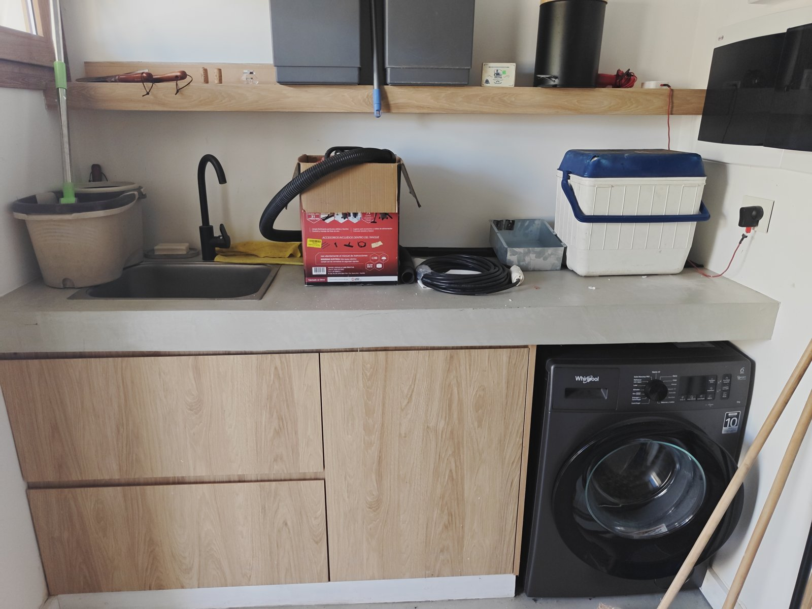
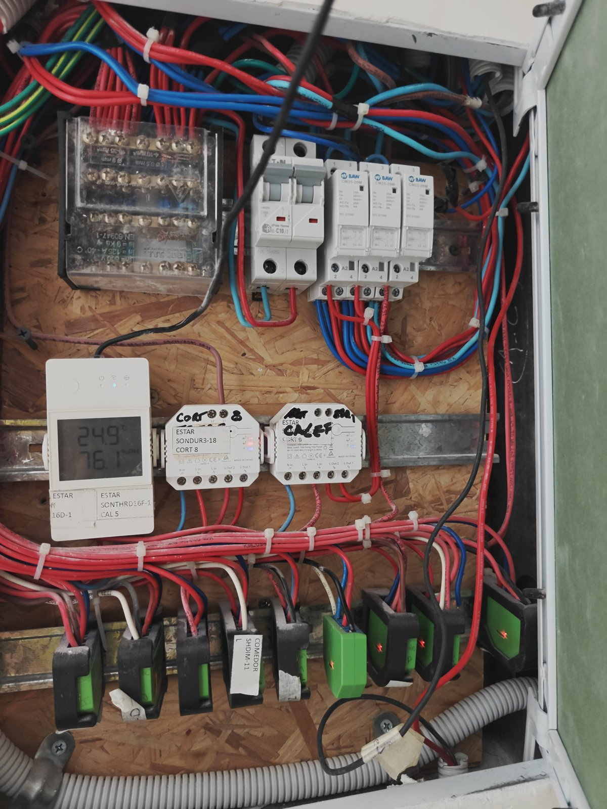
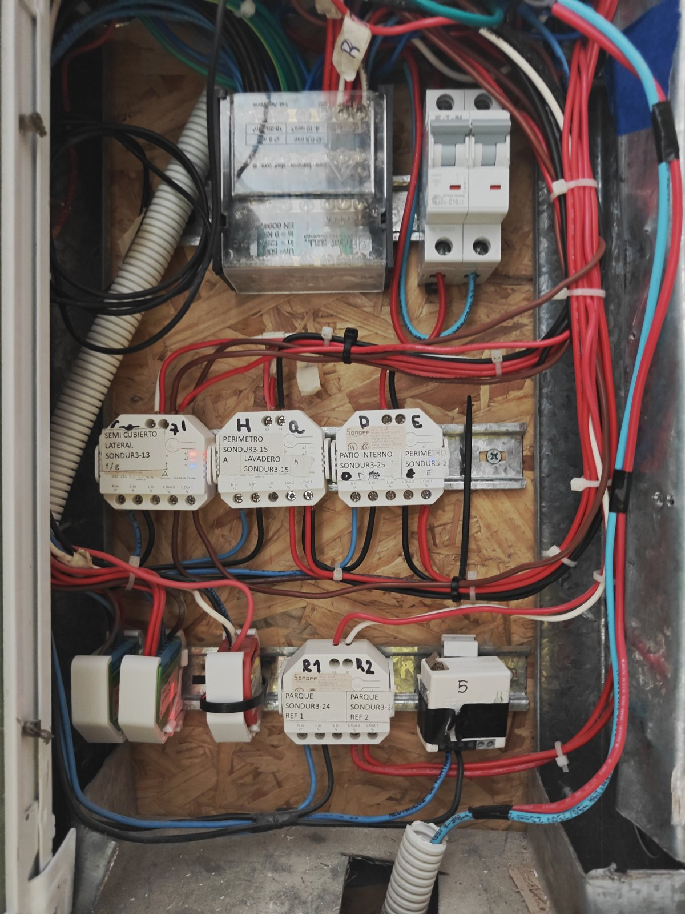
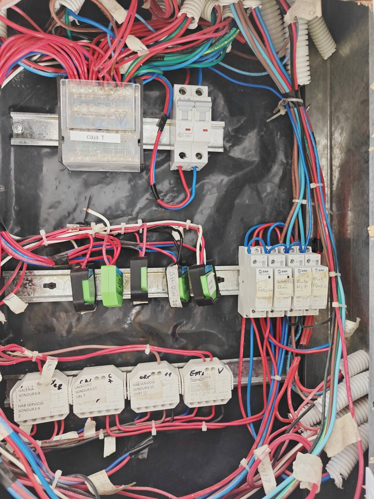
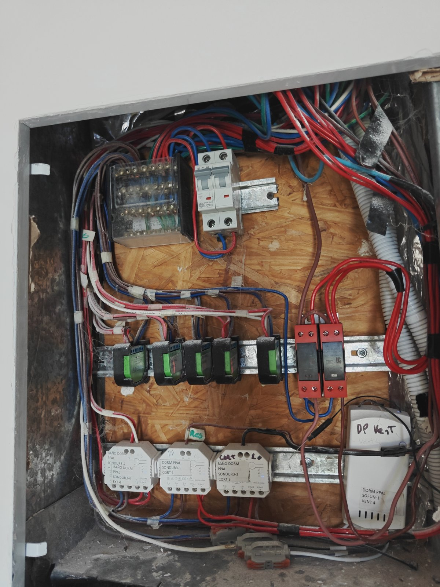
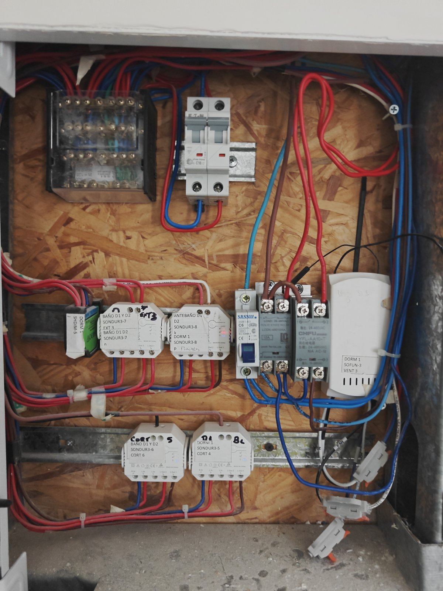
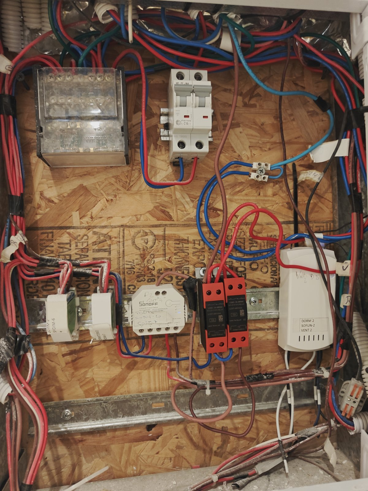
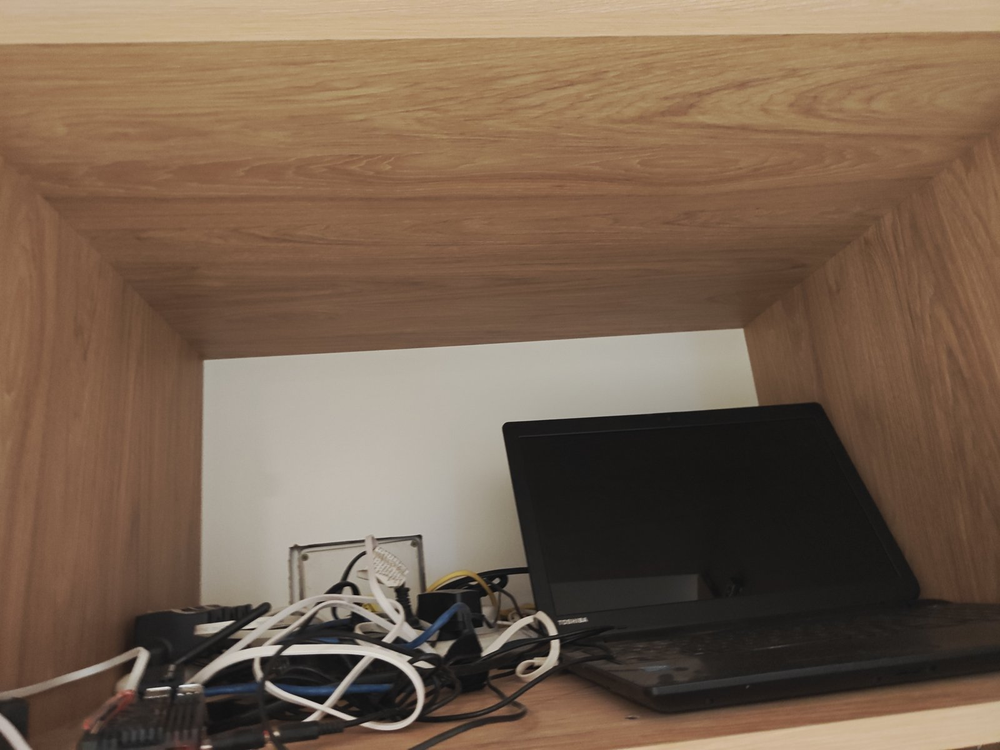
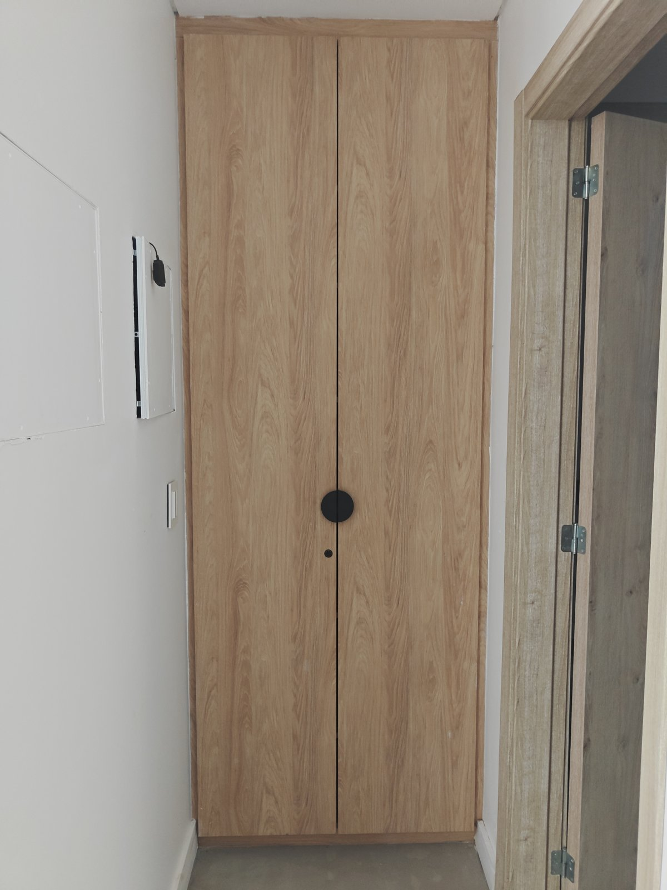
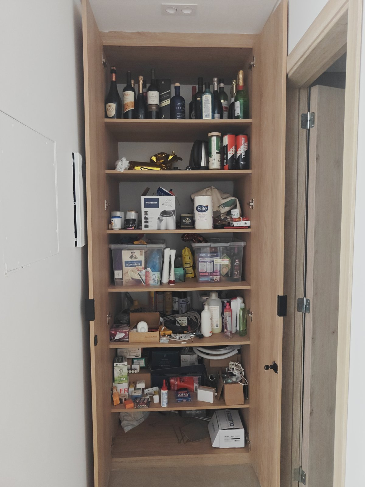

# Costa 204 — manual interno (propietarios)

Lo técnico de la casa: tableros, energía, agua y equipos. **No va a los huéspedes** (para eso
está [`manual-uso.md`](manual-uso.md)). Cada equipo tiene su nombre fijo en el
[glosario](glosario.md); las fotos están listadas en [`fotos/README.md`](fotos/README.md).
Espejo en Notion: 🔧 Manual interno (subpágina de 🌊 Costa 204).

Reglas: nada de claves ni códigos (alarma, Wi-Fi, cerraduras, cuentas de los equipos). Los
datos marcados *a confirmar* salen de leer una foto y no se verificaron en el lugar.

---

## Lavadero: el cuarto técnico de la casa

En el lavadero está casi todo lo técnico: tableros eléctricos, medidor de tensión, inversores y
baterías, termotanque, tablero de los paneles solares y sensor de corte de luz. El ablandador de
agua está en un placard aparte.

### Tableros eléctricos (térmicas y disyuntores)

Dos tableros Conextube uno al lado del otro, en la pared del lavadero, con el **medidor de
tensión** arriba. Cada uno tiene su **corte general** arriba a la izquierda.

**Tablero izquierdo**

| Fila | Posición (de izq. a der.) | Equipo | Rótulo |
|---|---|---|---|
| Arriba | 1 | Disyuntor Schneider 63 A, 30 mA | **Corte general** |
| Arriba | 2–4 | Térmicas C20 ×3 | sin rótulo legible |
| Arriba | 5 | Térmica C16 | Tomas habitación |
| Arriba | 6 | Térmica C16 | Tomas living |
| Arriba | 7 | Térmica C10 | Iluminación tablero (¿3?) |
| Abajo | 1 | Térmica C16 | Tomas habitación de servicio |
| Abajo | 2 | Térmica BAW C20 | Termotanque y tomas del lavadero |
| Abajo | 3 | Térmica Schneider C25 | A mano: calefacción … dormitorios (*a confirmar*) |
| Abajo | 4 | Térmica Schneider C25 | A mano: calefacción cocina / galería, "6" (*a confirmar*) |
| Abajo | 5 | Térmica C16 | sin rótulo |
| Abajo | 6 | Térmica tetrapolar Sica C25 | sin rótulo (*¿trifásico: aire York?*, a confirmar) |
| Abajo | 7 | Disyuntor Sica 25 A | Riego, pileta, iluminación exterior |

**Tablero derecho**

| Fila | Posición | Equipo | Rótulo |
|---|---|---|---|
| Arriba | 1 | Disyuntor tetrapolar Sica 63 A, 30 mA | **Corte general** |
| Arriba | 2 | Térmica C16 | Tomas cocina (mesadas) |
| Arriba | 3 | Térmica C16 | Iluminación tablero 1 |
| Arriba | 4 | Térmica C16 | Iluminación tablero 2 |
| Arriba | 5 | Térmica C20 | sin rótulo |
| Arriba | 6 | Disyuntor Schneider 63 A, 30 mA | Disyuntor tomas heladera |
| Arriba | 7 | Térmica C16 | Tomas heladera |
| Abajo | 1 | Schneider C20 | **CAL SUITE** (calefacción habitación principal) |
| Abajo | 2 | Schneider C20 | **CAL HAB 1** (dormitorio 1) |
| Abajo | 3 | Schneider C25 | **CAL HAB 2** (dormitorio 2) |
| Abajo | 4 | Schneider C25 | **CAL COMEDOR 1 y 2** (*a confirmar*) |
| Abajo | 5 | Térmica C20 | Horno / microondas |
| Abajo | 6 | Térmica C20 | Termotanque habitaciones |
| Abajo | 7–8 | Térmicas C20 ×2 | sin rótulo |

> Pendiente: recorrer térmica por térmica (bajarla y ver qué se apaga en HA) y completar los
> "sin rótulo". Conviene reemplazar los rótulos a mano por etiquetas impresas con estos nombres.

Si salta un disyuntor (corte general o 30 mA): suele ser humedad o un equipo con fuga
(exterior, pileta, riego). Bajar las térmicas de ese tablero, subir el disyuntor y volver a
subirlas una por una hasta ver cuál lo hace saltar.

### Medidor de tensión

Display arriba de los tableros. Muestra la tensión de cada fase (en la foto, "VR" = fase R,
220 V); con los botones se pasa a S y T. Si una fase marca muy bajo o cero, falta esa fase de
la red: avisar a la distribuidora.

> Home Assistant mide el consumo por fase con su propio medidor (R, S, T): ver
> `AGENTS.md` (aire York, bomba de riego en la fase S).

### Inversores, baterías y tablero solar

- **3 inversores/cargadores QMAX** (uno por fase) con sus **3 unidades de comando** QMAX a la
  izquierda. Dan respaldo con baterías durante un corte de luz.
- **Banco de baterías Brensolma** (gabinete blanco abajo).
- Sobre el inversor del medio hay una **cámara Sonoff** que mira los equipos.
- **Tablero de los paneles solares**: gabinete beige debajo del termotanque (Brensolma).

No tocar los inversores ni las baterías sin el instalador. En un corte de luz la casa sigue
con batería y Home Assistant bloquea algunos equipos para no descargarla (ver
`AGENTS.md`, "Cortes de luz").

### Sensor de corte de luz

Módulo naranja enchufado en el tomacorriente debajo del termotanque (foto anterior). Detecta
cuándo falta la red para que Home Assistant pase al modo corte. **No desenchufarlo**. *Entidad
de HA a confirmar.*

### Termotanque eléctrico del lavadero

Rheem eléctrico, colgado a la derecha de los inversores. Térmica: "termotanque y tomas del
lavadero" (tablero izquierdo). El otro termotanque es el de las habitaciones (tablero
derecho). Los dos los controla el limitador de potencia de Home Assistant.

### Ablandador de agua

En el placard de dos hojas con tirador redondo negro.

- Equipo Vital Water con válvula electrónica (display con la hora) y **tanque de sal azul**.
- Mantenimiento: que el tanque tenga siempre sal (reponer cuando se vea el agua o quede poca);
  si se corta la luz, revisar que la hora del display sea la correcta, porque regenera de noche.
- Está enchufado al tomacorriente de la izquierda: no desenchufarlo.

### Lavarropas y bacha

Lavarropas **Whirlpool** de carga frontal (10 kg) debajo de la mesada; bacha de lavar a la
izquierda. Tomas: "termotanque y tomas del lavadero".

---

## Tablero de domótica 5 (hall, pasillo del toilette)

En el hall hay dos tableros, uno al lado del otro, detrás de tapas blancas en la pared del
antetoilette. Este es el de la **derecha, el más cercano al placard de los dueños** (el que
tiene el termostato con pantalla). Es el
"TABLERO 5" de la planilla de diseño (estar, comedor, cocina):

- Bornera de distribución, térmica **C10 bipolar** y **3 contactores BAW CM25** (calefacción
  eléctrica de estar / cocina-comedor).
- **Sonoff THR316D** "SONTHRD16F-1 / CAL 5": termostato del estar (muestra temperatura y
  humedad).
- **Sonoff Dual R3** "SONDUR3-18 / CORT 8": cortina del ventanal del estar
  (`cover.sonoff_10013b0576`).
- **Sonoff Dual R3** rotulado "CORT 9", re-rotulado a mano **"CALEF"**: hoy se usa para
  calefacción, no para la cortina 9.
- Fila de **Shelly Dimmer 2** (SHDIM-8 a 16): pasillo y barra de la cocina, mesada, spots y
  colgante del comedor, pared, spots, centro y techo del ventanal del estar.
  **SHDIM-11 (spots del comedor) está fuera de servicio** (ver `mantenimiento.md`). El LED de
  estos Shelly no siempre se ve prendido: para saber si andan, mirar si están disponibles en
  HA (el 11/11 respondían todos menos SHDIM-11).

## Tablero de domótica 7 (exterior; hall, el de la izquierda, más lejos del placard)

"TABLERO 7" de la planilla: luces exteriores. Bornera, térmica **C10 bipolar** y:

| Equipo (rótulo) | Canales (rótulo en la tapa) | En HA |
|---|---|---|
| Sonoff Dual R3 SONDUR3-13 "Semicubierto lateral" (F/G) | techo del semicubierto / placard (pasillo de acceso) | `switch.sonoff_10013b00fb_1/_2` |
| Sonoff Dual R3 SONDUR3-15 "Perímetro (a) / Lavadero (H)" | perímetro fondo, luz del lavadero | `switch.sonoff_10013aec78_1/_2` |
| Sonoff Dual R3 SONDUR3-25 "Patio interno (D) / Perímetro (E)" | estacas del patio interno, apliques del perímetro frente | `switch.sonoff_10013b0bb7_1/_2` |
| Sonoff Dual R3 SONDUR3-24 "Parque REF 1 / REF 2" | reflectores del fondo | `switch.sonoff_10013b1377_1/_2` |
| 3 módulos chicos (abajo a la izquierda) y un módulo rotulado "5" | *a identificar* | — |

> Ojo, SONDUR3-25: el rótulo pone **Perímetro (E)** del lado de la salida 1 y **Patio
> interno (D)** del lado de la salida 2, pero en HA `_1` se llama "Patio interno" y `_2`
> "Perímetro frente". Coincide con lo que se vio con las teclas: **los nombres en HA están
> invertidos**. Corregirlos verificando a la vista de noche.

## Tablero de domótica 6 (galería)

"TABLERO 6" de la planilla (galería, parrilla, baño de la galería, habitación de servicio,
lavadero). **En el pasillo de servicio** (de la galería al baño y al dormitorio de servicio).
Bornera ("caja 1"), térmica **C10 bipolar** y:

| Equipo (rótulo) | Qué maneja | En HA |
|---|---|---|
| 5 Shelly Dimmer 2 (SHDIM-17 a 21) | galería living, spots comedor galería, barra, pasillo, colgante comedor galería | `light.luz_galeria_living`, `light.shellydimmer2_409151588222`, `light.luz_barra_galeria`, `light.pasillogaleria`, `light.luz_colagante_comedor_galeria` |
| 4 contactores BAW CM25 rotulados "Cocina", "Lavad. / Dorm. servicio", "Gale NS P", "Gal Parrilla" | calefacción eléctrica por zona | (los manejan termostatos/NSPanel) |
| Sonoff Dual R3 SONDUR3-9 "Galería Y / Hab. servicio Z" | luz de la parrilla, luz de la habitación de servicio | `switch.sonoff_10013b0692_1/_2` |
| Sonoff Dual R3 SONDUR3-17 "Lavadero CAL 7" (y CAL 8) | calefacción del lavadero y de la habitación de servicio | — |
| Sonoff Dual R3 SONDUR3-11 "Hab. servicio CORT 11" | cortina de la habitación de servicio | `cover.sonoff_10013af1d0` |
| Sonoff Dual R3 SONDUR3-12 "Galería" (EXT 1 / V) | extractor y luz del baño de la galería | `switch.sonoff_10013afde4_1/_2` |

## Tablero de domótica 1 (habitación principal)

"TABLERO 1" de la planilla. **Detrás de la puerta** de la habitación principal (igual que los
de los dormitorios 1 y 2). Bornera, térmica **C10 bipolar** y:

| Equipo (rótulo) | Qué maneja | En HA |
|---|---|---|
| 5 Shelly Dimmer 2 (SHDIM-1 a 4 y 21 de la planilla) | pasillo/hall de la habitación, centro, mesas de luz izq. y der., vestidor | `light.luz_pasillo_habitacion_prinicipal`, `light.luz_centro_habitacion_principal`, `light.mesa_de_luz_izquierda_habitaci`, `light.mesa_de_luz_derecha_habitacion_prinicipal`, `light.luz_vestidor_suite` |
| 2 relés de estado sólido (rojos, 10 A) | calefacción de la habitación y del baño (NSPanel) | `climate.sonoff_10017cb77f` |
| Sonoff Dual R3 "Baño dorm ppal SONDUR3-4" (EXT 4 / m) | extractor y luz del baño principal | `switch.sonoff_100155b613_1` (extractor) |
| Sonoff Dual R3 "Dorm ppal SONDUR3-1 CORT 1" | cortina blackout de la habitación | *verificar `cover`* |
| Sonoff Dual R3 "Baño dorm ppal SONDUR3-3 CORT 3" | cortina del baño principal | *verificar `cover`* |
| Sonoff iFan "DORM PPAL SOFUN-1 VENT 4" | ventilador de techo | `light.sonoff_10013f3f5e_1` y su ventilador |

## Tablero de domótica 2 (dormitorio 1)

"TABLERO 2" de la planilla (dormitorio 1, antebaño y baño de los dormitorios 1 y 2).
**Detrás de la puerta** del dormitorio 1. Bornera, térmica **C10 bipolar** y:

| Equipo (rótulo) | Qué maneja | En HA |
|---|---|---|
| Shelly Dimmer 2 "DORM 1 SHDIM-5" | spots del centro del dormitorio 1 | `light.centro_dormitorio_1` |
| Sonoff Dual R3 "Baño D1 y D2 SONDUR3-7" (EXT 3 / n) | extractor y luz del baño de los dormitorios | `switch.sonoff_10013b015e_1/_2` |
| Sonoff Dual R3 "Antebaño D1 D2 (k) / Dorm 1 (p) placard SONDUR3-8" | luz del antebaño y **tira LED del placard del dormitorio 1** | `switch.sonoff_10015f67ee_1` (antebaño) / `_2` |
| Sonoff Dual R3 "Baño D1 y D2 SONDUR3-6 CORT 6" | cortina del baño de los dormitorios | *verificar cuál `cover`* |
| Sonoff Dual R3 "Dorm 1 SONDUR3-5 CORT 4" (a mano "D1") | cortina del dormitorio 1 | *verificar cuál `cover`* |
| Térmica **C6** (Sassin) + 2 relés de estado sólido (LCDK / CHFU, 10 A) | calefacción eléctrica (accionada por el NSPanel) | — |
| Sonoff iFan "DORM 1 SOFUN-3 VENT 3" | ventilador de techo del dormitorio 1 | `light.sonoff_1001589bec_1` y su ventilador |

> Con el rótulo de SONDUR3-8 se explica la tecla junto al panel del dormitorio 1: su canal 2
> es la **tira LED del placard del dormitorio 1** (en HA se llama "Antebaño Dormitorios", nombre
> equivocado). Ese canal se apaga y prende en 0,2 s con cada toque: revisar el modo de entrada
> en eWeLink y renombrarlo "Placard dormitorio 1".

## Tablero de domótica 3 (dormitorio 2)

"TABLERO 3" de la planilla (dormitorio 2 y hall de los dormitorios). **Detrás de la puerta**
del dormitorio 2. Bornera, térmica **C10 bipolar** y:

| Equipo (rótulo) | Qué maneja | En HA |
|---|---|---|
| Shelly Dimmer 2 "DORM 2 SHDIM-6" | spots del dormitorio 2 | `light.luz_spots_dormitorio_2` |
| Shelly Dimmer 2 (rótulo "…dormitorio…", SHDIM-7 según planilla) | techo del hall de los dormitorios | `light.luz_techo_hall_dormitorios` |
| Sonoff Dual R3 "D2 SONDUR-20 CORT 7" | cortina (blackout) del dormitorio 2 | `cover.sonoff_100155bb02` "Cortina Dormitorio 2" |
| 2 relés de estado sólido (rojos, LCDT-48D10AA, 10 A) | calefacción eléctrica (accionados por el NSPanel) | — |
| Sonoff iFan "DORM 2 SOFUN-2 VENT 2" | ventilador de techo del dormitorio 2 (luz + velocidades) | `light.sonoff_10013f3c51_1` y su ventilador |

## Equipos de red (placard del dormitorio 2, estante de arriba)

Router, switch y **Raspberry Pi**, más una notebook Toshiba, en el estante alto del placard
del dormitorio 2. Es el corazón de la casa: sin esto no hay Wi-Fi, ni Home Assistant, ni
cerraduras por app, ni avisos. **No desenchufar** ni mover cables. *A completar: qué equipo
corre Home Assistant (Raspberry o notebook) y para qué está la notebook.*
Pendiente: alerta si se cae (por ejemplo, ping externo/Nabu Casa) y ordenar cables.

## Llaveros de acceso (huéspedes)

Dos llaveros, cada uno con la **tarjeta de la cerradura principal** (rotulada con su número) y
una **tarjeta de la puerta lateral** (TTLock, "Smart keycard"). La foto de los llaveros **no se
guarda** (se ven los cortes de las llaves mecánicas).

| Llavero | Principal (Tuya) | Lateral (TTLock): nombre en la app hoy | Verificado |
|---|---|---|---|
| 102 | tarjeta n.º 102 (`event.puerta_principal_unlock_user_card`, value 102) | "Inquilino 2" | Principal 11/11 11:50:55; lateral 11:48:37 |
| 103 | tarjeta n.º 103 (value 103) | "inquilino" | Principal 11/11 11:51:09; lateral 11:49:00 |

El aviso de Telegram (`automation.cerradura_puerta_principal_avisos_por_telegram`) traduce
las dos puertas a "el huésped (llavero 102/103)" (variables `tarjetas` y `operadores_lateral`).
Si se renombran las tarjetas en la app TTLock, actualizar `operadores_lateral`.

## Placard de los dueños (hall, junto al antetoilette)

Placard de dos puertas, **uso privado**, cerrado con llave durante las estadías (bebidas,
despensa, herramientas y repuestos eléctricos). Tiene un **sensor de movimiento Shelly
Motion** ("Sensor placard"): si se abre, avisa por Telegram; con la casa en Ausente o en modo
inquilino, además dispara la alerta (`automation.sensor_lateral_activado`) y puede activar la
alarma. Al revisarlo, desarmar antes la alarma.

## Cocina (datos técnicos)

Ver la parte de uso en `manual-uso.md`. Equipos: anafe a gas **Orbis** de 4 hornallas, campana,
horno empotrado en la columna, lavavajillas **Drean**, horno eléctrico tipo air fryer **CUK**,
tostadora y pava eléctrica. En la isla: **NSPanel Pro** y parlante Google.
Térmicas: "tomas cocina (mesadas)", "horno / microondas", "tomas heladera" (tablero derecho).

---

## Otros registros

- Colector solar de la pileta, bombas y su seguimiento: [`mantenimiento.md`](mantenimiento.md).
- Paneles NSPanel: [`nspanel.md`](nspanel.md).
- Teclas y luces, ambiente por ambiente: [`manual-uso.md`](manual-uso.md) (las notas internas
  con entidades de HA están ahí, marcadas "Nota interna").
